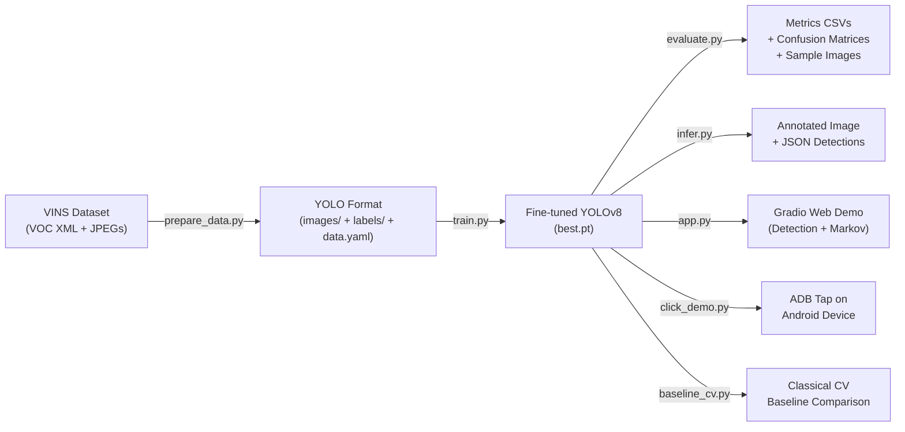
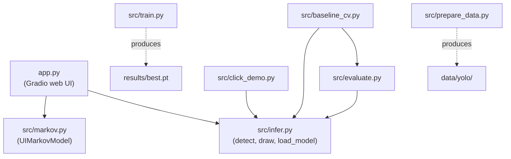

# PROJECT REPORT — GUI Element Detector

---

## 1. Project Title, Purpose, and Problem Statement

**Title:** GUI Element Detector

**One-line purpose:** A deep-learning system that takes a mobile app screenshot as input and outputs labelled bounding boxes for every UI element (buttons, text, icons, text fields, switches, checkboxes, etc.).

**Problem it solves:** Traditional test-automation tools locate tappable elements through XPath selectors or accessibility IDs. These break when the app's layout changes and do not exist at all for games, Flutter/Unity apps, or remote-desktop screens. This project replaces that fragile coupling with a vision-only detector that finds "the login button" the same way a human does — from the pixels alone.

---

## 2. Motivation and Target Users

**Motivation:** Enable UI test automation that is decoupled from the underlying view hierarchy by using object detection on screenshots. The system also adds a Markov-chain layer to model the sequential layout order of elements (top→bottom), which can predict which UI-element type is most likely to follow another.

**Target users:**
- QA / test-automation engineers who need to interact with apps that lack accessibility metadata.
- Researchers in UI understanding, mobile app analysis, and automated GUI testing.
- Students (the README explicitly contains a "short version for the report / viva" section and includes a Colab notebook for training without a local GPU).

---

## 3. Complete Tech Stack

### Language
- **Python** (3.10+ required; developed/reported on Python 3.14)

### Core Libraries (from `requirements.txt`)

| Library | Version constraint | Role |
|---|---|---|
| `torch` | >= 2.2 | Deep learning framework (PyTorch) |
| `torchvision` | (latest compatible) | Image transforms, pretrained backbones |
| `ultralytics` | >= 8.3 | YOLOv8 training, inference, evaluation API |
| `gradio` | >= 4.0 | Web demo UI |
| `opencv-python` | (latest) | Image I/O, drawing, Canny edge detection |
| `pillow` | (latest) | Image handling (Gradio/matplotlib dependency) |
| `matplotlib` | (latest) | Plotting: heatmaps, training curves |
| `pandas` | (latest) | CSV metrics, dataframes |
| `easyocr` | (latest, optional) | OCR for reading text inside detected bounding boxes |

### Additional tools / services
- **Google Colab** (T4 GPU) — alternative training environment via `notebooks/train_colab.ipynb`.
- **ADB (Android Debug Bridge)** — optional, used by `src/click_demo.py` for live device interaction.
- **gdown** — optional, for downloading the VINS dataset from Google Drive.

### Reported runtime environment
Apple M2 Pro (32 GB), PyTorch 2.14, MPS backend, Ultralytics 8.4, Python 3.14. Training also runs on NVIDIA CUDA GPUs (device `0`) or CPU.

---

## 4. System Architecture

### High-level data flow



### Module dependency graph



### APIs and External Services
- **No REST API or backend server** is exposed. The Gradio app runs locally on `http://127.0.0.1:7860`.
- **ADB** is used as an external binary for device screenshot capture and tap injection (`click_demo.py`).
- **EasyOCR** runs locally (CPU-only by default); no cloud OCR service is used.
- **Google Drive** is referenced only for downloading the VINS dataset (via `gdown`).

---

## 5. Folder Structure

```
gui-detector/
├── app.py                          Gradio web demo: upload screenshot → detection + Markov analysis
├── requirements.txt                Python dependencies with version constraints
├── README.md                       Full project documentation (374 lines)
├── gitignore                       Git ignore rules (note: file lacks leading dot)
├── PROJECT_REPORT.md               This report
│
├── src/
│   ├── prepare_data.py             VOC XML → YOLO txt conversion, 70/15/15 split, class counts
│   ├── train.py                    Fine-tune YOLOv8 with custom augmentation settings
│   ├── evaluate.py                 Test-set metrics, per-class AP, confusion matrix, sample images
│   ├── infer.py                    Single-image inference → annotated image + JSON
│   ├── markov.py                   First-order Markov chain: layout sequence modeling
│   ├── click_demo.py              ADB screenshot → detect → tap element on Android device
│   └── baseline_cv.py             Classical CV baseline (Canny edges + contours)
│
├── notebooks/
│   └── train_colab.ipynb           Colab notebook: download VINS, train both models, evaluate
│
├── weights/
│   ├── yolov8s.pt                  COCO-pretrained YOLOv8s (22.6 MB, 11.1M params)
│   └── yolov8n.pt                  COCO-pretrained YOLOv8n (6.5 MB, 3.1M params)
│
├── data/
│   ├── raw/                        Raw VINS download (All Dataset/) — not committed
│   ├── yolo/                       Converted dataset: images/, labels/, data.yaml — generated
│   └── custom_test/                User-provided screenshots for custom evaluation
│
└── results/
    ├── best.pt                     Main model weights (YOLOv8s, 22.5 MB)
    ├── yolov8s_640_best.pt         YOLOv8s best checkpoint (copy of best.pt)
    ├── yolov8n_640_best.pt         YOLOv8n best checkpoint (6.5 MB)
    ├── metrics.csv                 Per-class P/R/mAP for the main model
    ├── comparison.csv              Side-by-side model comparison table
    ├── class_counts.csv            Box counts per class per split
    ├── baseline_comparison.csv     Classical CV vs YOLO (class-agnostic)
    ├── confusion_matrix.png        Confusion matrix (YOLOv8s, test split)
    ├── confusion_matrix_normalized.png
    ├── BoxPR_curve.png             Precision-recall curves
    ├── training_curves_yolov8s.png Training loss/metric curves
    ├── training_curves_yolov8n.png
    ├── baseline_example.jpg        Side-by-side: Canny baseline vs YOLO
    ├── eval/
    │   ├── yolov8s_640/            Full eval output: metrics, curves, val batches, per_image.csv
    │   └── yolov8n_640/            Same for the smaller model
    ├── runs/
    │   ├── yolov8s_640/            Ultralytics training run: args.yaml, results.csv, curves, weights
    │   └── yolov8n_640/            Same for YOLOv8n
    ├── samples/
    │   ├── 1_good_Rico_53697.jpg   Best test-image prediction (GT | pred side-by-side)
    │   ├── ...                     3 good + 3 failure cases
    │   └── notes.md                Per-sample stats
    ├── infer/
    │   └── Android_Android_101_pred.{jpg,json}  Example inference output
    └── label_check/                10 random training images with YOLO boxes drawn back on
```

---

## 6. Core Features and Implementation

### 6.1 Dataset Preparation (VOC → YOLO conversion)
- **File:** `src/prepare_data.py`
- **Key functions:** `parse_xml()`, `to_yolo_lines()`, `collect_pairs()`, `draw_check()`, `main()`
- **What it does:** Reads Pascal VOC XML annotations from 4 VINS subsets (Android, Rico, iphone, uplabs), excluding Wireframes. Merges spelling variants (`Checkbox`/`CheckBox` → `CheckedTextView`), drops classes with <100 boxes, converts bounding boxes to YOLO normalised format `(cls xc yc w h)`, splits data 70/15/15 with seed 42, writes `data.yaml`, produces `class_counts.csv` and 10 label-check images.
- **Class list (13 classes):** Text, Icon, Image, TextButton, UpperTaskBar, EditText, PageIndicator, CheckedTextView, BackgroundImage, Modal, Toolbar, Drawer, Switch.

### 6.2 Model Training (YOLOv8 Fine-tuning)
- **File:** `src/train.py`
- **Key functions:** `pick_device()`, `main()`
- **What it does:** Loads a COCO-pretrained YOLOv8 model, fine-tunes it on the converted VINS dataset with custom augmentation settings (no flips, no mosaic, no mixup), early stopping patience 15, seed 42, deterministic mode. Auto-selects CUDA → MPS → CPU. Copies best weights to `results/<name>_best.pt`.

### 6.3 Evaluation
- **File:** `src/evaluate.py`
- **Key functions:** `load_gt()`, `iou_matrix()`, `match()`, `per_image_analysis()`, `save_samples()`, `run_custom_test()`, `main()`
- **What it does:** Runs `model.val()` on the test split to compute standard COCO metrics (P, R, mAP@0.5, mAP@0.5:0.95). Then runs custom per-image analysis with greedy IoU matching to compute per-image F1 and recall broken down by COCO box-size bins (small <32², medium, large >96²). With `--main` flag, also saves 3 best + 3 worst sample predictions and runs custom-test inference.

### 6.4 Single-Image Inference
- **File:** `src/infer.py`
- **Key functions:** `load_model()`, `detect()`, `add_ocr_text()`, `find_by_text()`, `draw()`, `read_image()`
- **What it does:** Loads the model, runs `model.predict()` on a BGR image, returns a list of detection dicts with class, confidence, bounding box (x, y, w, h), and center point. Optionally runs EasyOCR on Text/TextButton/EditText crops. Outputs an annotated JPEG and a JSON file.

### 6.5 Markov Chain Layout Modeling
- **File:** `src/markov.py`
- **Key class:** `UIMarkovModel`
- **Key methods:** `extract_sequence()`, `add_sequence()`, `get_transition_matrix()`, `plot_heatmap()`, `generate_report()`
- **What it does:** Sorts detected elements by vertical position (y, then x) to form a "reading order" sequence. Builds a first-order discrete Markov chain transition count matrix. Computes transition probabilities P(next_class | current_class). Renders a heatmap and generates a markdown report with top transitions and next-element prediction.

### 6.6 Gradio Web Demo
- **File:** `app.py`
- **What it does:** Two-panel Gradio Blocks UI. Left: image upload + confidence slider + OCR checkbox + "Accumulate Markov" checkbox. Right: annotated image. Below: Markov heatmap + markdown report + raw JSON accordion. Supports example images from the test set. Reset button clears accumulated Markov state.

### 6.7 Click Demo (Android ADB)
- **File:** `src/click_demo.py`
- **Key functions:** `adb()`, `check_device()`, `screenshot()`, `main()`
- **What it does:** Captures a live screenshot via `adb exec-out screencap`, runs YOLO detection, selects a target element by class (default: EditText, fallback: TextButton) or by OCR text match, and taps its center via `adb shell input tap`. Supports `--dry-run`, `--cls`, `--index`, `--text` flags.

### 6.8 Classical CV Baseline
- **File:** `src/baseline_cv.py`
- **Key functions:** `cv_boxes()`, `main()`
- **What it does:** Grayscale → Canny edge detection (thresholds 50, 150) → morphological dilation (joins letters) → external contour finding → bounding boxes. Compared with the YOLO model class-agnostically (IoU ≥ 0.5).

---

## 7. Algorithms, Models, and Logic

### 7.1 Object Detection Model

**Architecture:** YOLOv8s (small variant) from Ultralytics.
- 11.1 million parameters.
- Single-stage anchor-free detector: processes the full image in one forward pass to predict all bounding boxes and class probabilities simultaneously.
- Backbone: CSPDarknet (modified). Neck: PANet with C2f modules. Head: decoupled detection head outputting box regression + classification.

**Pretrained weights:** COCO (everyday objects, 80 classes). The final detection head is replaced for 13 UI-element classes during fine-tuning.

**Comparison model:** YOLOv8n (nano, 3.1M parameters), same architecture family but fewer channels/layers.

### 7.2 Training Setup

| Parameter | Value | Source |
|---|---|---|
| Input resolution | 640 × 640 | `args.yaml`, `train.py` |
| Epochs (max) | 100 | `train.py` |
| Early stopping patience | 15 epochs | `train.py` |
| Batch size | 16 | `args.yaml` |
| Optimizer | auto (Ultralytics selects SGD or AdamW) | `args.yaml` |
| Initial learning rate | 0.01 | `args.yaml` |
| Final LR factor | 0.01 | `args.yaml` |
| Momentum | 0.937 | `args.yaml` |
| Weight decay | 0.0005 | `args.yaml` |
| Warmup epochs | 3.0 | `args.yaml` |
| Warmup momentum | 0.8 | `args.yaml` |
| Warmup bias LR | 0.1 | `args.yaml` |
| AMP (mixed precision) | True | `args.yaml` |
| Seed | 42 | `train.py` |
| Deterministic | True | `train.py` |
| Workers | 4 | `train.py` |
| Device used | MPS (Apple Silicon) | `args.yaml` |

### 7.3 Loss Functions (from `args.yaml`)

YOLOv8 uses a composite loss:
- **Box loss weight:** 7.5 (CIoU-based regression loss)
- **Classification loss weight:** 0.5 (binary cross-entropy)
- **DFL (Distribution Focal Loss) weight:** 1.5 (for fine-grained box regression)

### 7.4 Augmentation (explicitly configured in `train.py`)

| Augmentation | Setting | Rationale |
|---|---|---|
| HSV hue shift | 0.015 | Colour variation |
| HSV saturation | 0.5 | Colour variation |
| HSV value (brightness) | 0.4 | Lighting variation |
| Scale | ±20% (0.2) | Light zoom |
| Horizontal flip | **0.0 (disabled)** | UI layouts not mirror-symmetric |
| Vertical flip | 0.0 | Not meaningful for UIs |
| Rotation, translate, shear, perspective | All 0.0 | UIs are axis-aligned |
| Mosaic | **0.0 (disabled)** | Stitching 4 screenshots creates unrealistic layouts |
| Mixup, copy-paste | 0.0 | Disabled |
| Erasing | 0.4 | Enabled (Ultralytics default) |

### 7.5 Dataset

- **Dataset:** VINS (Visual Identification of UI Elements using Neural Networks, CHI 2021)
- **Source:** [github.com/sbunian/VINS](https://github.com/sbunian/VINS)
- **Google Drive ID:** `1ucti2ujNJgKV-Ts_mXALA7BZ97iPv8h6`
- **Total annotated screenshots:** ~4,800; **used:** 4,550 real screenshots (Wireframes subset of 257 excluded)
- **Subsets used:** Android, Rico, iphone, uplabs
- **Annotation format:** Pascal VOC XML with bounding boxes
- **Split:** 70 / 15 / 15 → 3,185 train / 682 val / 683 test images, random seed 42
- **Total bounding boxes:** 63,806 (across 13 classes after merging/dropping)
- **Average elements per screenshot:** ~14

### 7.6 Data Preprocessing (`prepare_data.py`)

1. Parse each VOC XML file for `(class_name, xmin, ymin, xmax, ymax)` and image dimensions.
2. Apply class merging: `Checkbox` / `CheckBox` → `CheckedTextView`.
3. Drop rare classes (<100 boxes total): `Card`, `Multi_Tab`, `Bottom_Navigation`, `Spinner`, `Map`, `Remember`.
4. If XML-declared image size disagrees with actual pixel dimensions, rescale box coordinates proportionally.
5. Clip boxes to image boundaries; skip degenerate boxes (width or height < 2 px).
6. Convert to YOLO normalised format: `class_id xc yc w h` (all values in [0, 1]).
7. Prefix filenames with subset name to avoid collisions (e.g., `Rico_53697`).
8. Write `data.yaml` with relative paths so the folder is portable (e.g., to Colab).

### 7.7 IoU Matching Algorithm (`evaluate.py`)

The `match()` function implements **greedy bipartite matching**:
1. Compute the full IoU matrix between all prediction boxes and all ground-truth boxes.
2. Iterate over predictions (assumed sorted by descending confidence from YOLO).
3. For each prediction, find the ground-truth box with the highest IoU that (a) is not already matched and (b) has the same class (when `class_aware=True`).
4. If that best IoU ≥ threshold (default 0.5), count it as a true positive and mark the GT box as used.

### 7.8 Markov Chain Model (`markov.py`)

1. **Sequence extraction:** Sort detected bounding boxes by `(y, x)` position (top-to-bottom, left-to-right reading order). Extract the class name sequence.
2. **Transition counting:** For consecutive pairs `(A, B)` in the sequence, increment `transitions[A][B]`.
3. **Probability matrix:** For each state (class), normalise counts to get `P(next = B | current = A) = count(A→B) / Σ_j count(A→j)`.
4. **Accumulation mode:** The Gradio app can accumulate transitions across multiple screenshots to build a richer model, or compute per-screen-only matrices.
5. **Prediction:** For the last element in a sequence, report the most probable next element type.

### 7.9 Classical CV Baseline (`baseline_cv.py`)

1. Convert to grayscale.
2. Canny edge detection (thresholds 50, 150).
3. Morphological dilation with a rectangular kernel sized `max(3, round(max(h,w)/200))` wide × half that tall, to merge letter-level edges into word/element blobs.
4. Find external contours (`RETR_EXTERNAL`).
5. Convert contours to bounding rectangles.
6. Filter: drop boxes smaller than 0.02% or larger than 90% of image area.

---

## 8. Database Schema / Data Storage

**No database is used.** All data storage is file-based:

| Data | Format | Location |
|---|---|---|
| Raw annotations | Pascal VOC XML | `data/raw/All Dataset/<subset>/Annotations/*.xml` |
| Raw images | JPEG | `data/raw/All Dataset/<subset>/JPEGImages/*.jpg` |
| Converted labels | YOLO txt (one line per box) | `data/yolo/labels/{train,val,test}/*.txt` |
| Converted images | JPEG (copied) | `data/yolo/images/{train,val,test}/*.jpg` |
| Dataset config | YAML | `data/yolo/data.yaml` |
| Model weights | PyTorch checkpoint (.pt) | `results/*.pt`, `weights/*.pt` |
| Metrics | CSV | `results/metrics.csv`, `results/comparison.csv`, etc. |
| Inference output | JSON + JPEG | `results/infer/<name>_pred.{json,jpg}` |
| Markov state | In-memory Python dicts | `UIMarkovModel.transitions`, `UIMarkovModel.state_counts` |

---

## 9. Key Code Snippets

### 9.1 YOLO Inference Pipeline (`src/infer.py`, `detect()`)

```python
def detect(model, image_bgr, conf=0.25, imgsz=640, ocr=False):
    res = model.predict(image_bgr, conf=conf, imgsz=imgsz, verbose=False)[0]
    dets = []
    for (x1, y1, x2, y2), c, cls in zip(res.boxes.xyxy.tolist(), res.boxes.conf.tolist(),
                                       res.boxes.cls.tolist()):
        x, y, w, h = round(x1), round(y1), round(x2 - x1), round(y2 - y1)
        dets.append({
            "class": res.names[int(cls)],
            "class_id": int(cls),
            "confidence": round(c, 3),
            "box": {"x": x, "y": y, "w": w, "h": h},
            "center": [x + w // 2, y + h // 2],
        })
    if ocr:
        add_ocr_text(image_bgr, dets)
    return dets
```

### 9.2 VOC → YOLO Coordinate Conversion (`src/prepare_data.py`, `to_yolo_lines()`)

```python
def to_yolo_lines(img_w, img_h, objs, stats):
    lines = []
    for name, x1, y1, x2, y2 in objs:
        name = MERGE.get(name, name)
        if name in DROP or name not in CLASSES:
            stats["dropped"][name] += 1
            continue
        x1, x2 = max(0, min(x1, x2)), min(img_w, max(x1, x2))
        y1, y2 = max(0, min(y1, y2)), min(img_h, max(y1, y2))
        if x2 - x1 < 2 or y2 - y1 < 2:
            stats["degenerate"] += 1
            continue
        xc, yc = (x1 + x2) / 2 / img_w, (y1 + y2) / 2 / img_h
        bw, bh = (x2 - x1) / img_w, (y2 - y1) / img_h
        lines.append(f"{CLASSES.index(name)} {xc:.6f} {yc:.6f} {bw:.6f} {bh:.6f}")
        stats["kept"][name] += 1
    return lines
```

### 9.3 Markov Transition Probability Calculation (`src/markov.py`)

```python
def get_transition_matrix(self, sequence_only=None):
    trans = defaultdict(lambda: defaultdict(int))
    if sequence_only is not None:
        if len(sequence_only) >= 2:
            for a, b in zip(sequence_only[:-1], sequence_only[1:]):
                trans[a][b] += 1
    else:
        trans = self.transitions
    states = sorted(set(trans.keys()) | {b for row in trans.values() for b in row.keys()})
    mat = np.zeros((len(states), len(states)), dtype=float)
    for i, s1 in enumerate(states):
        total = sum(trans[s1].values())
        if total > 0:
            for j, s2 in enumerate(states):
                mat[i, j] = trans[s1][s2] / total
    return pd.DataFrame(mat, index=states, columns=states)
```

### 9.4 IoU Matrix Computation (`src/evaluate.py`)

```python
def iou_matrix(a, b):
    if len(a) == 0 or len(b) == 0:
        return np.zeros((len(a), len(b)))
    x1 = np.maximum(a[:, None, 0], b[None, :, 0])
    y1 = np.maximum(a[:, None, 1], b[None, :, 1])
    x2 = np.minimum(a[:, None, 2], b[None, :, 2])
    y2 = np.minimum(a[:, None, 3], b[None, :, 3])
    inter = np.clip(x2 - x1, 0, None) * np.clip(y2 - y1, 0, None)
    area = lambda r: (r[:, 2] - r[:, 0]) * (r[:, 3] - r[:, 1])
    return inter / (area(a)[:, None] + area(b)[None, :] - inter + 1e-9)
```

### 9.5 Canny + Contour Baseline (`src/baseline_cv.py`)

```python
def cv_boxes(img):
    gray = cv2.cvtColor(img, cv2.COLOR_BGR2GRAY)
    edges = cv2.Canny(gray, 50, 150)
    k = max(3, round(max(img.shape[:2]) / 200))
    blobs = cv2.dilate(edges, cv2.getStructuringElement(cv2.MORPH_RECT, (k * 2, k)), iterations=1)
    contours, _ = cv2.findContours(blobs, cv2.RETR_EXTERNAL, cv2.CHAIN_APPROX_SIMPLE)
    h, w = img.shape[:2]
    boxes = []
    for c in contours:
        x, y, bw, bh = cv2.boundingRect(c)
        if bw * bh < 0.0002 * w * h or bw * bh > 0.9 * w * h:
            continue
        boxes.append([x, y, x + bw, y + bh])
    return np.array(boxes, float).reshape(-1, 4)
```

---

## 10. Testing and Results

### 10.1 Test Split
- 683 images, 9,453 ground-truth bounding boxes.

### 10.2 Main Model Results (YOLOv8s, test split)

| Metric | Value |
|---|---|
| **Precision** | 0.880 |
| **Recall** | 0.848 |
| **mAP@0.5** | **0.894** |
| **mAP@0.5:0.95** | **0.823** |
| Inference time | 34 ms/image (M2 Pro MPS, batch 16) |
| Training epochs | 49 total, best at epoch 34 |
| Training time | ~2.9 hours (Apple M2 Pro) |

### 10.3 YOLOv8n Comparison (test split)

| Metric | YOLOv8s | YOLOv8n |
|---|---|---|
| Parameters | 11.1M | 3.1M |
| Precision | 0.880 | 0.877 |
| Recall | 0.848 | 0.844 |
| mAP@0.5 | 0.894 | 0.909 |
| mAP@0.5:0.95 | 0.823 | 0.825 |
| ms/image | 34.1 | 16.2 |
| Best epoch | 34 | 42 |

YOLOv8n's higher mAP@0.5 is driven by one class (BackgroundImage); on 12/13 classes YOLOv8s is better.

### 10.4 Per-Class AP (YOLOv8s)

| Class | Instances | Precision | Recall | AP@0.5 | AP@0.5:0.95 |
|---|---:|---:|---:|---:|---:|
| Text | 4348 | 0.937 | 0.947 | 0.957 | 0.869 |
| Icon | 1684 | 0.902 | 0.925 | 0.946 | 0.838 |
| Image | 1205 | 0.866 | 0.826 | 0.904 | 0.849 |
| TextButton | 741 | 0.957 | 0.981 | 0.991 | 0.984 |
| UpperTaskBar | 564 | 1.000 | 0.886 | 0.974 | 0.911 |
| EditText | 348 | 0.884 | 0.965 | 0.963 | 0.911 |
| PageIndicator | 221 | 0.980 | 0.977 | 0.992 | 0.806 |
| CheckedTextView | 101 | 0.744 | 0.812 | 0.849 | 0.758 |
| BackgroundImage | 91 | 0.882 | **0.165** | **0.492** | **0.385** |
| Modal | 44 | 0.879 | 0.825 | 0.895 | 0.838 |
| Toolbar | 30 | **0.480** | 0.900 | 0.784 | 0.715 |
| Drawer | 31 | 0.925 | 0.968 | 0.992 | 0.969 |
| Switch | 45 | 0.999 | 0.844 | 0.886 | 0.861 |

### 10.5 Recall by Box Size (at model input 640px)

| Size category | GT boxes | Recall |
|---|---:|---:|
| Small (<32×32 px) | 4,178 | 0.927 |
| Medium | 3,615 | 0.907 |
| Large (>96×96 px) | 1,660 | 0.908 |

Small elements are detected as reliably as larger ones.

### 10.6 Classical CV Baseline Comparison (class-agnostic, IoU ≥ 0.5)

| Method | Precision | Recall | F1 |
|---|---:|---:|---:|
| Canny + contours | 0.356 | 0.633 | 0.456 |
| YOLOv8s (class ignored) | 0.879 | 0.937 | **0.907** |

### 10.7 Training Convergence (from `results.csv`)
- Epoch 1: mAP@0.5:0.95 = 0.637
- Epoch 10: mAP@0.5:0.95 = 0.780
- Epoch 20: mAP@0.5:0.95 = 0.819
- Epoch 34 (best): mAP@0.5:0.95 = **0.829** (val)
- Early stopping triggered at epoch 49.

### 10.8 Unit / Integration Tests
**NOT FOUND.** No test files (`test_*.py`, `*_test.py`, `pytest.ini`, `tox.ini`, `setup.cfg` with test config) are present. The codebase validates correctness through the label-check images and the evaluation pipeline rather than automated unit tests.

---

## 11. Challenges Visible in the Code

### 11.1 No TODO/FIXME/HACK Comments
A search across all source files found **zero** TODO, FIXME, HACK, or WORKAROUND comments. The code is clean of explicit technical debt markers.

### 11.2 Implicit Workarounds

1. **Non-ASCII path handling** (`infer.py:96-101`): `cv2.imread()` fails on Windows paths with non-ASCII characters. The `read_image()` function works around this by using `np.fromfile()` + `cv2.imdecode()` instead.

2. **XML/image dimension mismatch** (`prepare_data.py:138-140`): Some VINS XML files declare image sizes that disagree with the actual pixel dimensions. The code detects this and rescales bounding box coordinates proportionally — a workaround for inconsistent upstream annotations.

3. **Class merging and dropping** (`prepare_data.py:36-38`): `Checkbox` and `CheckBox` are spelling variants of the same concept; the code merges them. Six classes with <100 boxes are dropped entirely because they would produce meaningless AP scores.

4. **Box clipping and degenerate filtering** (`prepare_data.py:64-66`): Boxes are clipped to image boundaries and boxes with width or height <2 pixels are silently dropped.

5. **Lazy OCR import** (`infer.py:59`): EasyOCR is imported only when first needed (`import easyocr` inside `add_ocr_text()`), because it has a heavy startup time and is optional.

6. **Batch size fallback** (`train.py:53`): Auto-batch (`-1`) only works on CUDA; on MPS/CPU the code falls back to 16.

7. **gitignore file** is named `gitignore` without the leading dot, suggesting it may not be active.

---

## 12. Limitations of the Current Implementation

1. **BackgroundImage class is unreliable** (AP@0.5 = 0.49, recall 0.17). Full-screen background photos have no clear border and are mostly missed entirely. The class is also unstable between training runs.

2. **Annotation convention mismatch:** VINS annotators only labelled elements in the foreground layer. When a popup covers a list, the visible list items behind it are not annotated. The model correctly detects them, but they count as false positives.

3. **Missing widget classes:** Cards, bottom navigation bars, tabs, spinners, dropdowns, maps, and sliders are too rare in VINS to learn. Their constituent parts are detected as Text/Icon/TextButton instead.

4. **No "clickable" attribute:** The model classifies by visual appearance, not by function. A `Text` could be a tappable link; an `Icon` might not be interactive. VINS has no interactivity labels.

5. **Domain specificity:** Trained on 2016–2020 era Android/iOS phone apps. Tablets, dark mode, games, and web pages may work less well.

6. **OCR performance:** EasyOCR runs on CPU only (hardcoded `gpu=False`), processes each text box serially, and can misread stylised fonts.

7. **Single training run:** All reported numbers come from one run with seed 42. Expect ±1 point variation between runs and GPU types (full determinism not guaranteed on GPU).

8. **Markov model is first-order only:** Only considers the immediately preceding element, not longer-range layout patterns.

9. **Markov reading order is a simple (y, x) sort:** Does not account for multi-column layouts, tabs, or overlapping elements.

10. **No Markov model persistence:** Accumulated transitions are stored only in memory and lost when the Gradio server restarts.

11. **Click demo never tested on a real device** (stated in README: "This was not run on a device during development, because no emulator was available").

---

## 13. Possible Future Improvements

1. **Higher-order Markov chains or sequence models** (bigram → trigram, or an RNN/Transformer) for layout prediction.
2. **Markov model persistence** — save/load accumulated transitions to disk (JSON or pickle).
3. **Train at 960px resolution** for potentially better small-element detection (infrastructure already in code: `--imgsz 960`).
4. **Expand the class set** using a larger or more modern UI dataset (e.g., CLAY, Screen2Words, RICO with semantic annotations).
5. **Add a "clickable" binary classifier** as a second head or post-processing step.
6. **GPU-accelerated OCR** — enable EasyOCR's GPU mode or switch to PaddleOCR.
7. **Batch OCR** — process all text crops in one pass instead of one-by-one.
8. **Dark mode / tablet / web page augmentation** — retrain with style-transfer or additional datasets.
9. **Hungarian matching** instead of greedy matching in `evaluate.py` for optimal bipartite assignment.
10. **Automated unit tests** for data preparation, inference, and Markov logic.
11. **Multi-column layout awareness** in the Markov sequence extractor (e.g., using spatial clustering before vertical sorting).
12. **Model export** to ONNX or TFLite for on-device inference.
13. **CI/CD pipeline** with linting, testing, and model regression checks.
14. **Fix `gitignore`** — rename to `.gitignore` so Git actually uses it.

---

## 14. Libraries, Papers, and Datasets Referenced

### Dataset
- **VINS** — S. Bunian et al., "VINS: Visual Search for Mobile User Interface Design," CHI 2021. GitHub: [github.com/sbunian/VINS](https://github.com/sbunian/VINS). Google Drive file ID: `1ucti2ujNJgKV-Ts_mXALA7BZ97iPv8h6`.

### Model / Framework
- **YOLOv8** — Ultralytics, 2023. Used via the `ultralytics` Python package (≥ 8.3). No specific paper is cited; the Ultralytics library docs are the reference.
- **COCO** — The pretrained weights (`yolov8s.pt`, `yolov8n.pt`) are trained on Microsoft COCO. No explicit citation in the code.

### Libraries (all from `requirements.txt` and imports)
- PyTorch (`torch`, `torchvision`)
- Ultralytics (`ultralytics`)
- OpenCV (`opencv-python` / `cv2`)
- EasyOCR (`easyocr`)
- Gradio (`gradio`)
- Matplotlib (`matplotlib`)
- Pandas (`pandas`)
- Pillow (`pillow`)
- NumPy (`numpy` — transitive dependency)
- Python standard library: `xml.etree.ElementTree`, `json`, `argparse`, `pathlib`, `subprocess`, `shutil`, `random`, `collections`

### Other references
- **COCO size definitions** (small <32², medium 32²–96², large >96²) are used in `evaluate.py` for size-based recall breakdown.
- **Pascal VOC XML format** — the annotation format used by VINS.

---

## 15. Screenshots Worth Capturing for a Research Paper

### 15.1 Screenshots to Capture (not yet as images in the project)

| # | Screen / Page | State / Input | How to Reach |
|---|---|---|---|
| 1 | **Gradio web demo — main view** | Upload a screenshot, confidence 0.25, detect pressed. Show annotated image on right. | `python app.py` → open `http://127.0.0.1:7860` → upload any test screenshot → click Detect |
| 2 | **Gradio — Markov heatmap panel** | Same as above but scroll down to see the Markov transition heatmap + markdown report side by side | Same as #1, scroll below the detection output |
| 3 | **Gradio — JSON accordion expanded** | Expand the "View Raw Detections (JSON)" accordion showing structured output | Same as #1, click the accordion |
| 4 | **Gradio — OCR text mode** | Check "OCR Text", detect on a screenshot with text buttons. JSON should show `"text"` fields. | Same as #1, tick "OCR Text" checkbox before clicking Detect |
| 5 | **Gradio — accumulated Markov** | Process 3–5 screenshots with "Accumulate Markov Transitions" checked. Show the richer heatmap. | Upload and detect multiple screenshots sequentially |
| 6 | **Click demo annotated output** | Show `results/click_demo.jpg` with the red circle on the tap target | `python src/click_demo.py --dry-run` (requires ADB + emulator) |
| 7 | **Terminal — training progress** | Show the Ultralytics training table output with epoch, loss, and metric columns | `python src/train.py --epochs 1 --fraction 0.05` |
| 8 | **Terminal — evaluation output** | Show the per-class metrics table printed to console | `python src/evaluate.py --weights results/best.pt --main` |

### 15.2 Existing Images, Plots, and Output Files

| # | File Path | Description |
|---|---|---|
| 1 | `results/infer/Android_Android_101_pred.jpg` | Example inference: annotated screenshot with detected UI elements |
| 2 | `results/confusion_matrix.png` | 13-class confusion matrix (YOLOv8s, test split) |
| 3 | `results/confusion_matrix_normalized.png` | Normalized confusion matrix (row-wise percentages) |
| 4 | `results/BoxPR_curve.png` | Precision-Recall curves per class |
| 5 | `results/training_curves_yolov8s.png` | Training loss + validation metric curves (YOLOv8s) |
| 6 | `results/training_curves_yolov8n.png` | Training curves (YOLOv8n) |
| 7 | `results/baseline_example.jpg` | Side-by-side: Canny+contour boxes vs YOLO predictions |
| 8 | `results/samples/1_good_Rico_53697.jpg` | Best prediction: GT vs pred side-by-side (F1=1.0) |
| 9 | `results/samples/2_good_Rico_40951.jpg` | Second best prediction (F1=1.0) |
| 10 | `results/samples/3_good_Rico_3720.jpg` | Third best prediction (F1=1.0) |
| 11 | `results/samples/4_fail_iphone_IMG_3890.jpg` | Failure: popup over list, model finds hidden elements |
| 12 | `results/samples/5_fail_Rico_12718.jpg` | Failure: picture-in-picture, model detects UI inside photo |
| 13 | `results/samples/6_fail_Rico_52410.jpg` | Failure: low-contrast elements on busy background |
| 14 | `results/eval/yolov8s_640/BoxF1_curve.png` | F1 confidence curve (YOLOv8s) |
| 15 | `results/eval/yolov8s_640/BoxP_curve.png` | Precision confidence curve |
| 16 | `results/eval/yolov8s_640/BoxR_curve.png` | Recall confidence curve |
| 17 | `results/eval/yolov8s_640/confusion_matrix.png` | Confusion matrix from eval run |
| 18 | `results/eval/yolov8s_640/val_batch0_labels.jpg` | Validation batch: ground truth labels |
| 19 | `results/eval/yolov8s_640/val_batch0_pred.jpg` | Validation batch: model predictions |
| 20 | `results/eval/yolov8n_640/BoxF1_curve.png` | F1 confidence curve (YOLOv8n) |
| 21 | `results/eval/yolov8n_640/BoxPR_curve.png` | PR curve (YOLOv8n) |
| 22 | `results/eval/yolov8n_640/confusion_matrix.png` | Confusion matrix (YOLOv8n) |
| 23 | `results/runs/yolov8s_640/results.png` | Ultralytics multi-panel training curves plot |
| 24 | `results/runs/yolov8s_640/labels.jpg` | Dataset label distribution visualization |
| 25 | `results/runs/yolov8s_640/train_batch0.jpg` | Sample training batch with augmented images |
| 26 | `results/runs/yolov8s_640/train_batch1.jpg` | Second training batch sample |
| 27 | `results/runs/yolov8s_640/train_batch2.jpg` | Third training batch sample |
| 28 | `results/runs/yolov8n_640/results.png` | YOLOv8n multi-panel training curves |
| 29 | `results/runs/yolov8n_640/labels.jpg` | Dataset label distribution (YOLOv8n run) |
| 30 | `results/label_check/*.jpg` | 10 random training images with converted YOLO boxes drawn back on (conversion verification) |

### 15.3 Key CSV Data Files (for tables/charts in a paper)

| File | Contents |
|---|---|
| `results/metrics.csv` | Per-class P/R/mAP (13 classes + overall) |
| `results/comparison.csv` | YOLOv8s vs YOLOv8n: params, speed, all metrics |
| `results/class_counts.csv` | Box count per class per split (train/val/test) |
| `results/baseline_comparison.csv` | Classical CV baseline vs YOLO (P/R/F1) |
| `results/eval/yolov8s_640/size_recall.csv` | Recall by box size (small/medium/large) |
| `results/eval/yolov8s_640/per_image.csv` | Per-image precision/recall/F1 for all 683 test images |
| `results/runs/yolov8s_640/results.csv` | Epoch-by-epoch training logs (49 epochs × 15 columns) |

---

*Report generated from codebase analysis on 2026-11-18. All information sourced exclusively from the project's source code, configuration files, output files, and README.*
