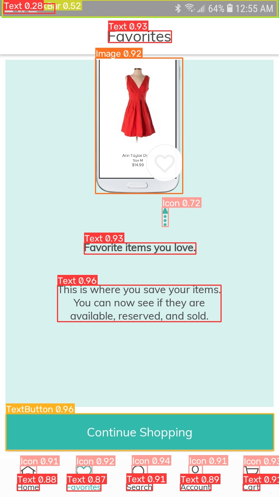
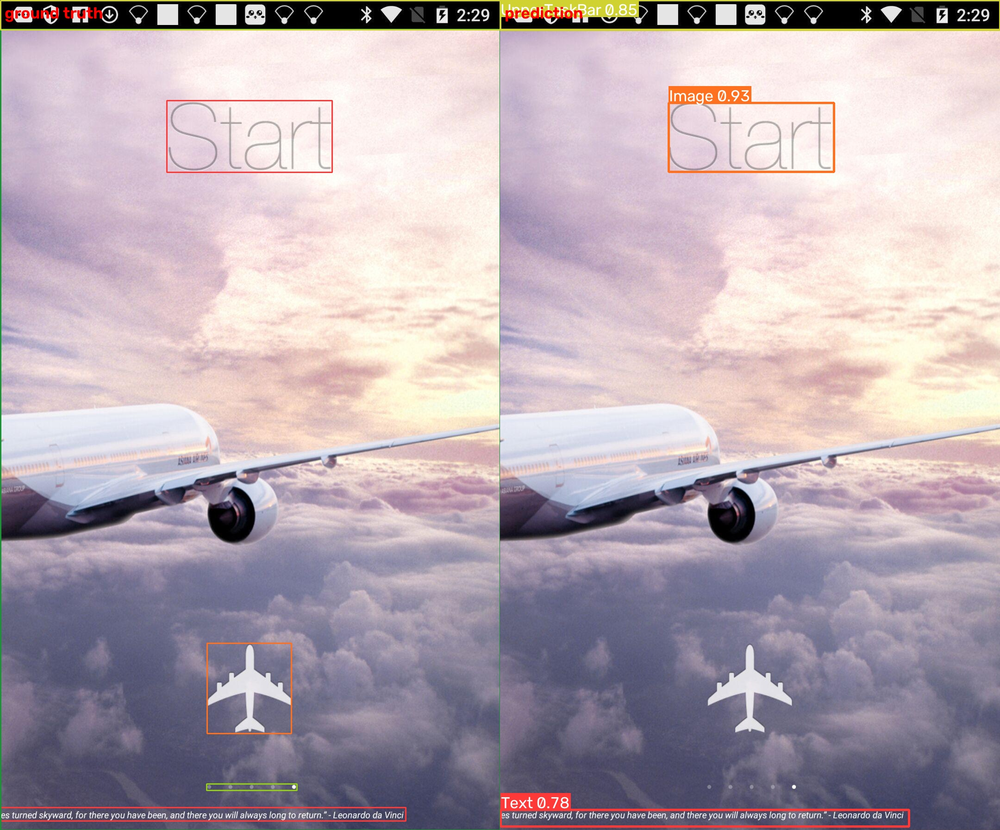

# GUI Element Detector

A deep learning model that looks at a **mobile app screenshot** and finds the UI elements on it
(buttons, text, text fields, icons, images, switches, checkboxes, ...) as labelled bounding boxes.

Why: test-automation tools normally find what to tap through XPath or element IDs. Those break
when the app changes, and do not exist at all for games, Flutter/Unity apps or remote screens.
A detector that works **from the image alone** can find "the login button" the way a human does.



---

## How it works (short version for the report / viva)

**Problem.** Object detection: for every UI element in a screenshot, predict a box `(x, y, w, h)`
and a class (e.g. `TextButton`). One screenshot has ~14 elements on average, many of them tiny
(icons, single words).

**Dataset.** [VINS](https://github.com/sbunian/VINS) (CHI 2021): 4,800 hand-annotated UI screens
from Android (Rico + new apps), iPhone and UpLabs designs, with Pascal-VOC bounding boxes.
We use the **4,550 real screenshots** (we leave out 257 hand-drawn wireframes because the use case
is real screenshots), split **70 / 15 / 15** = 3,185 train / 682 val / 683 test images, random seed 42.

**Model.** **YOLOv8s** (11 M parameters), pretrained on COCO (everyday photos) and **fine-tuned** on
VINS. YOLO looks at the image once and predicts all boxes in a single pass, so it is fast
(a few ms per image on a GPU). Fine-tuning reuses what the network already knows about edges,
shapes and text-like texture, which is why it reaches good accuracy after ~35 epochs.
We compared it with the smaller **YOLOv8n** (3 M parameters).

**Augmentation.** Only colour/brightness changes and light scaling (±20 %).
No horizontal flips: UI layouts are not mirror-symmetric (back arrows are on the left,
text reads left-to-right), so flipped screenshots would teach the model unrealistic layouts.
No mosaic either, because stitching 4 screenshots together creates layouts that never occur.

**Results.** On the 683 unseen test screenshots the model reaches
**mAP@0.5 = 0.894** and **mAP@0.5:0.95 = 0.823** (precision 0.88, recall 0.85).
Common, visually distinct elements (TextButton, Text, Icon, EditText, Drawer) are found with AP@0.5 above 0.94.
The weak class is **BackgroundImage** (AP@0.5 0.49), explained below.
A classical computer-vision baseline (edges + contours) only reaches F1 0.46 versus 0.91 for the model.

**Metric in one line.** A predicted box is correct if it overlaps the true box by
IoU >= 0.5 and has the right class. AP is the area under the precision-recall curve for one class;
mAP is the mean over classes. mAP@0.5:0.95 averages over stricter overlap thresholds (0.5 ... 0.95),
so it also rewards tight boxes.

---

## Project structure

```
gui-detector/
  data/raw/            VINS as downloaded ("All Dataset/<subset>/Annotations|JPEGImages")
  data/yolo/           converted dataset: images/, labels/, data.yaml
  data/custom_test/    drop your own screenshots here (kept separate from the main results)
  src/prepare_data.py  VOC XML -> YOLO txt, 70/15/15 split, class counts, label check images
  src/train.py         fine-tune YOLOv8 (auto-picks CUDA GPU / Apple GPU / CPU)
  src/evaluate.py      test-set metrics, per-class AP, confusion matrix, sample images
  src/infer.py         CLI: screenshot -> annotated image + JSON (optional OCR)
  src/click_demo.py    adb screenshot -> detect -> tap an element on an emulator/phone
  src/baseline_cv.py   classical CV baseline (Canny + contours) for comparison
  app.py               Gradio web demo
  notebooks/train_colab.ipynb   train on a free Colab GPU instead
  results/             metrics, plots, sample predictions, weights (best.pt)
```

---

## Setup

Python 3.10 or newer. Commands are for **Windows (PowerShell / cmd)**; on macOS/Linux use
`source .venv/bin/activate` and `/` instead of `\`.

```bat
cd gui-detector
python -m venv .venv
.venv\Scripts\activate
pip install -r requirements.txt
```

If you have an NVIDIA GPU, install the CUDA build of PyTorch first (see https://pytorch.org, e.g.
`pip install torch torchvision --index-url https://download.pytorch.org/whl/cu124`), then the rest.
`easyocr` is only needed for the optional OCR feature.

### Get the dataset

Download VINS from the Google Drive link in the [VINS repo](https://github.com/sbunian/VINS)
(`All Dataset.zip`, ~1.1 GB) and unzip it so that this folder exists:

```
data\raw\All Dataset\Android\Annotations\*.xml
data\raw\All Dataset\Android\JPEGImages\*.jpg
data\raw\All Dataset\Rico\...   data\raw\All Dataset\iphone\...   data\raw\All Dataset\uplabs\...
```

Command-line download (works with `gdown` or `curl`):

```bat
pip install gdown
gdown 1ucti2ujNJgKV-Ts_mXALA7BZ97iPv8h6 -O data\raw\vins.zip
tar -xf data\raw\vins.zip -C data\raw
```

> Note: on networks with a TLS-inspecting proxy, Python downloads can fail with
> `CERTIFICATE_VERIFY_FAILED`. Downloading with a browser or `curl` and unzipping manually works.

---

## How to run each step (exact commands to reproduce)

```bat
:: 1. Convert to YOLO format (+ class counts and 10 label-check images)
python src\prepare_data.py

:: 2. Train the main model and the comparison model (same settings)
python src\train.py --model yolov8s.pt
python src\train.py --model yolov8n.pt
copy results\yolov8s_640_best.pt results\best.pt

:: 3. Evaluate on the held-out test split
python src\evaluate.py --weights results\yolov8n_640_best.pt
python src\evaluate.py --weights results\best.pt --name yolov8s_640 --main

:: 4. Classical CV baseline vs the model
python src\baseline_cv.py

:: 5. Detect elements in any screenshot -> results\infer\<name>_pred.jpg + .json
python src\infer.py path\to\screenshot.png
python src\infer.py path\to\screenshot.png --conf 0.4 --ocr

:: 6. Web demo -> open http://127.0.0.1:7860
python app.py
```

Training settings (all in `src/train.py`): image size 640, up to 100 epochs, early stopping
patience 15, batch 16 (auto batch on CUDA), SGD/AdamW chosen automatically by Ultralytics,
seed 42, deterministic mode. Quick smoke test: `python src\train.py --epochs 1 --fraction 0.05`.

**No GPU?** `train.py` falls back to CPU (very slow for this dataset). Use
`notebooks/train_colab.ipynb` on Google Colab (free T4 GPU) instead: it uploads the code,
downloads VINS, trains both models, evaluates them and lets you download `results.zip`.

### Inference JSON format

```json
[
  {"class": "TextButton", "class_id": 3, "confidence": 0.965,
   "box": {"x": 15, "y": 1065, "w": 691, "h": 95},
   "center": [360, 1112],
   "text": "Continue Shopping"}
]
```

`x, y` = top-left corner in pixels, `w, h` = width/height, `center` = where to tap.
`text` only appears with `--ocr` (Text / TextButton / EditText boxes).

---

## Dataset preparation

VINS has 21 raw label names. After conversion (`results/class_counts.csv`):

| class | train | val | test | total |
|---|---:|---:|---:|---:|
| Text | 20659 | 4317 | 4348 | 29324 |
| Icon | 7941 | 1623 | 1684 | 11248 |
| Image | 5807 | 1253 | 1205 | 8265 |
| TextButton | 3319 | 734 | 741 | 4794 |
| UpperTaskBar (status bar) | 2653 | 569 | 564 | 3786 |
| EditText (text field) | 1779 | 302 | 348 | 2429 |
| PageIndicator | 952 | 233 | 221 | 1406 |
| CheckedTextView (checkbox / radio) | 642 | 147 | 101 | 890 |
| BackgroundImage | 445 | 87 | 91 | 623 |
| Modal (pop-up) | 229 | 45 | 44 | 318 |
| Toolbar | 177 | 37 | 30 | 244 |
| Drawer (side menu) | 174 | 43 | 31 | 248 |
| Switch | 146 | 40 | 45 | 231 |

Class decisions:
- **Merged:** `Checkbox` and `CheckBox` (2 boxes each, spelling variants) -> `CheckedTextView`,
  which VINS already uses for checkboxes and radio buttons.
- **Dropped (< 100 boxes in the whole dataset):** `Card` (96, only 2 in the test split, so its AP
  would be meaningless), `Multi_Tab` (24), `Bottom_Navigation` (15), `Spinner` (9), `Map` (3),
  `Remember` (2). Those boxes are removed; the images stay.
- **Excluded subset:** `Wireframes` (257 hand-drawn mock-ups), because the goal is real screenshots.
- The data is imbalanced (Text is 46 % of all boxes, Switch 0.4 %). We kept the natural
  distribution; the rare classes still reach AP@0.5 >= 0.78 except BackgroundImage.

Label check: `results/label_check/` has 10 random training images with the converted boxes drawn
back on them. They line up with the UI elements, confirming the conversion is correct.

---

## Results

### Model comparison (test split, 683 images)

| model | params | precision | recall | mAP@0.5 | mAP@0.5:0.95 | ms / image* | recall small / medium / large | epochs (best) | train time |
|---|---:|---:|---:|---:|---:|---:|---|---:|---:|
| **YOLOv8s** (main, `results/best.pt`) | 11.1 M | 0.880 | 0.848 | 0.894 | 0.823 | 34 | 0.93 / 0.91 / 0.91 | 49 (34) | 2.9 h |
| YOLOv8n | 3.1 M | 0.877 | 0.844 | 0.909 | 0.825 | 16 | 0.93 / 0.93 / 0.93 | 57 (42) | 2.3 h |

\* inference time per image on the Apple M2 Pro GPU at batch 16 (an NVIDIA GPU is several times faster).

**Which is better?** The headline numbers are almost a tie, and YOLOv8n is even slightly ahead on
mAP@0.5. But that comes from **one class**: BackgroundImage (91 test boxes) scores AP@0.5:0.95
0.68 with YOLOv8n vs 0.39 with YOLOv8s. On **12 of the 13 classes YOLOv8s is better**
(+0.01 to +0.055 AP@0.5:0.95, biggest gains on Icon and CheckedTextView, i.e. small elements).
Without BackgroundImage, mean AP@0.5:0.95 is 0.859 (s) vs 0.837 (n). We therefore keep **YOLOv8s**
as the main model. YOLOv8n is a good choice when speed matters: it is about 2x faster and 3.5x
smaller for roughly 2 points less accuracy on most classes.

Training curves: `results/training_curves_yolov8s.png`, `results/training_curves_yolov8n.png`.

### Per-class results, YOLOv8s (`results/metrics.csv`)

| class | test boxes | precision | recall | AP@0.5 | AP@0.5:0.95 |
|---|---:|---:|---:|---:|---:|
| **all** | 9453 | 0.880 | 0.848 | **0.894** | **0.823** |
| Text | 4348 | 0.937 | 0.947 | 0.957 | 0.869 |
| Icon | 1684 | 0.902 | 0.925 | 0.946 | 0.838 |
| Image | 1205 | 0.866 | 0.826 | 0.904 | 0.849 |
| TextButton | 741 | 0.957 | 0.981 | 0.991 | 0.984 |
| UpperTaskBar | 564 | 1.000 | 0.886 | 0.974 | 0.911 |
| EditText | 348 | 0.884 | 0.965 | 0.963 | 0.911 |
| PageIndicator | 221 | 0.980 | 0.977 | 0.992 | 0.806 |
| CheckedTextView | 101 | 0.744 | 0.812 | 0.849 | 0.758 |
| BackgroundImage | 91 | 0.882 | **0.165** | **0.492** | **0.385** |
| Modal | 44 | 0.879 | 0.825 | 0.895 | 0.838 |
| Toolbar | 30 | **0.480** | 0.900 | 0.784 | 0.715 |
| Drawer | 31 | 0.925 | 0.968 | 0.992 | 0.969 |
| Switch | 45 | 0.999 | 0.844 | 0.886 | 0.861 |

Confusion matrix: `results/confusion_matrix.png` (and `confusion_matrix_normalized.png`).
Precision-recall curves: `results/BoxPR_curve.png`.

**Weak classes, honestly:**
- **BackgroundImage (AP@0.5 0.49, recall 0.17).** A full-screen photo behind the UI. It covers
  almost the whole screen, has no clear border and other elements sit on top of it, so the
  model mostly **does not predict a box for it at all** (it is rarely confused with `Image`;
  it is simply missed). With only 445 training examples there is little to learn from, and
  annotators were not consistent about which big photos count as "background".
  The class is also **unstable between runs**: YOLOv8n reached 0.81 AP@0.5 on it, so the
  YOLOv8s result is partly bad luck on a small class rather than a hard limit.
- **Toolbar (precision 0.48).** Most false Toolbars are the app bar right under the status bar
  (top 4 % of the screen) on screens where the annotators did not draw a Toolbar box, so part of
  this is inconsistent labelling. Only 30 test examples, so the number is noisy.
- **CheckedTextView (AP@0.5 0.85).** Small checkbox/radio glyphs with only 642 training examples;
  a few are called `Icon` or `TextButton`, and a few switches are called `CheckedTextView`.

### Small elements and image size

Recall at confidence 0.25, IoU 0.5, by box size after resizing to 640 px (COCO size definition):

| size | boxes | recall |
|---|---:|---:|
| small (< 32x32 px) | 4178 | 0.927 |
| medium | 3615 | 0.907 |
| large (> 96x96 px) | 1660 | 0.908 |

Small elements (icons, single words) are found **as well as** larger ones, so we did **not**
run the optional 960 px training: the problem it would fix is not present, and it would have
cost ~2.3x the training time. (Command if you want to try: `python src\train.py --imgsz 960`,
then `python src\evaluate.py --weights results\yolov8s_960_best.pt --imgsz 960`.)

### Classical CV baseline vs model (`results/baseline_comparison.csv`)

Baseline: grayscale -> Canny edges -> dilate (joins letters into words) -> external contours ->
bounding boxes. It cannot name classes, so both methods are scored **class-agnostically**
(a box is correct if it overlaps any real element with IoU >= 0.5).

| method | precision | recall | F1 | gives class names |
|---|---:|---:|---:|---|
| Canny + contours | 0.356 | 0.633 | 0.456 | no |
| YOLOv8s (class ignored) | 0.879 | 0.937 | 0.907 | yes |

The edge method fires on every texture (photos, gradients, shadows) and merges or splits
elements unpredictably, so most of its boxes are wrong. See `results/baseline_example.jpg`.

### Sample predictions (`results/samples/`, left = ground truth, right = model)

Chosen automatically from test images with >= 5 elements: the 3 with highest and the 3 with lowest
per-image F1 at confidence 0.25.

Good (F1 = 1.0): `1_good_Rico_53697.jpg`, `2_good_Rico_40951.jpg`, `3_good_Rico_3720.jpg`:
clean layouts with clear text, images and page indicators; every box matched.

Failures:
1. `4_fail_iphone_IMG_3890.jpg` (precision 0.28, recall 1.0): a **pop-up dialog over a list**.
   The annotators only labelled the dialog; the model also finds the real list items, tab icons
   and search bar visible behind it. Most "false positives" are real elements: this is a
   labelling-convention mismatch, not a model error.
2. `5_fail_Rico_12718.jpg` (precision 0.33): an **onboarding screen that contains a picture of
   another app screen**. Ground truth calls the picture one `Image`; the model detects the
   buttons and text drawn *inside* the picture.
3. `6_fail_Rico_52410.jpg` (recall 0.33): **white, low-contrast elements on a busy photo**.
   The thin airplane icon and the faint page-indicator dots are missed, the full-screen
   BackgroundImage is missed, and the very thin "Start" text is called an `Image`.



### Your own screenshots

Put `.png` / `.jpg` files into `data/custom_test/` and run
`python src\evaluate.py --weights results\best.pt --name yolov8s_640 --main`; annotated copies
are written to `results/custom_test/`. These are **not** part of the reported metrics.
(No custom screenshots were provided for this run.)

---

## Web demo (Gradio)

```bat
python app.py
```

Open http://127.0.0.1:7860, upload a screenshot (or click an example), move the confidence
slider, press **Detect**. You get the annotated image and the JSON list below it. Tick
"Read text" to run OCR on text elements.

---

## Click demo: tap an element on a real Android screen (optional)

`src/click_demo.py` takes a live screenshot with ADB, runs the model, picks an element and taps
its centre. No XPath, no element IDs: only pixels.

Setup (Windows):
1. Install **Android Studio**, open *Device Manager*, create a device (e.g. Pixel 7, API 34) and press Play.
   Or plug in an Android phone with *Developer options > USB debugging* on.
2. `adb` is in `%LOCALAPPDATA%\Android\Sdk\platform-tools`. Add that folder to PATH, or install
   only the [SDK Platform-Tools](https://developer.android.com/tools/releases/platform-tools).
3. Check: `adb devices` should list `emulator-5554  device`.

Run:

```bat
:: open an app with a login / search screen first, then:
python src\click_demo.py --dry-run                 :: detect + show target, no tap
python src\click_demo.py                           :: tap the first text field (EditText), else first TextButton
python src\click_demo.py --cls TextButton --index 1
python src\click_demo.py --text "Login"            :: OCR: tap the element whose text contains "Login"
```

The annotated screen with the tap point is saved to `results/click_demo.jpg`.
If `adb` or a device is missing the script exits with a message explaining what to set up.
(This was not run on a device during development, because no emulator was available.)

---

## Known limitations

- **Annotation conventions are inherited from VINS:** elements behind a pop-up and UI inside
  pictures are not labelled, so the model is "penalised" for finding them (see failures above).
- **BackgroundImage** is unreliable (mostly not detected); do not build automation on it.
- **No class for every widget:** cards, bottom navigation bars, tabs, spinners/dropdowns, maps and
  sliders were too rare to learn and are not detected as such (their parts usually come out as
  Text / Icon / TextButton).
- **Clickable or not:** the model detects what an element *looks like*. An `Icon` might not be
  tappable and a `Text` might be (links). VINS has no "clickable" label.
- **Domain:** trained on 2016-2020 era Android/iOS apps at phone aspect ratios. Tablets, dark
  modes, games and web pages may work less well. Use `data/custom_test` to check.
- **OCR** (EasyOCR) runs on CPU and is much slower than detection (it reads every text box one by
  one); it can also misread stylised fonts and punctuation.
- Numbers come from one training run with seed 42; expect small (+-1 point) variation between runs
  and between GPU types (full determinism is not guaranteed on GPU).

---

## Environment used for the reported numbers

Apple M2 Pro (32 GB), PyTorch 2.14 on the Apple GPU (MPS), Ultralytics 8.4, Python 3.14.
YOLOv8s trained for 49 epochs (early stop; best epoch 34) in about 2.9 h; YOLOv8n for 57 epochs (best epoch 42) in about 2.3 h.
The same code runs on a Windows PC with an NVIDIA GPU (device `0`) or on CPU.
